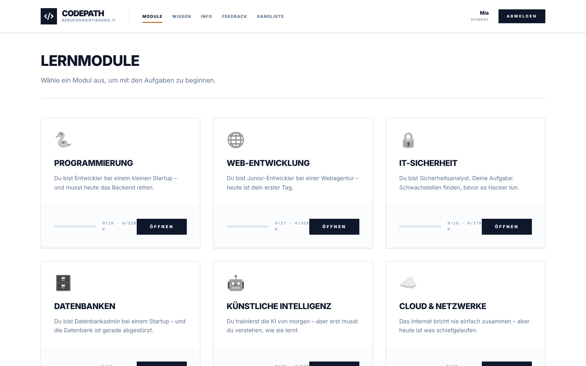
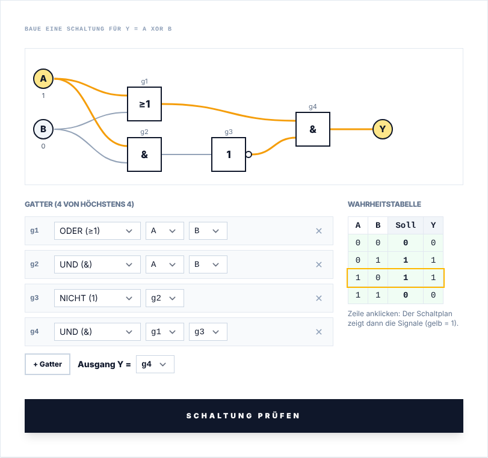
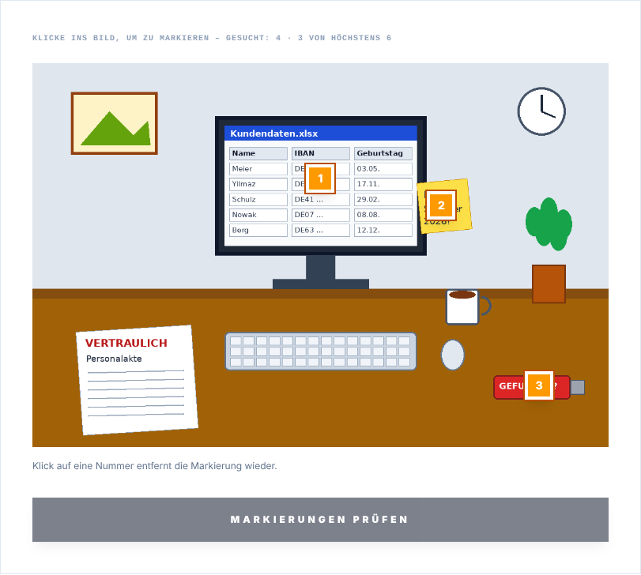
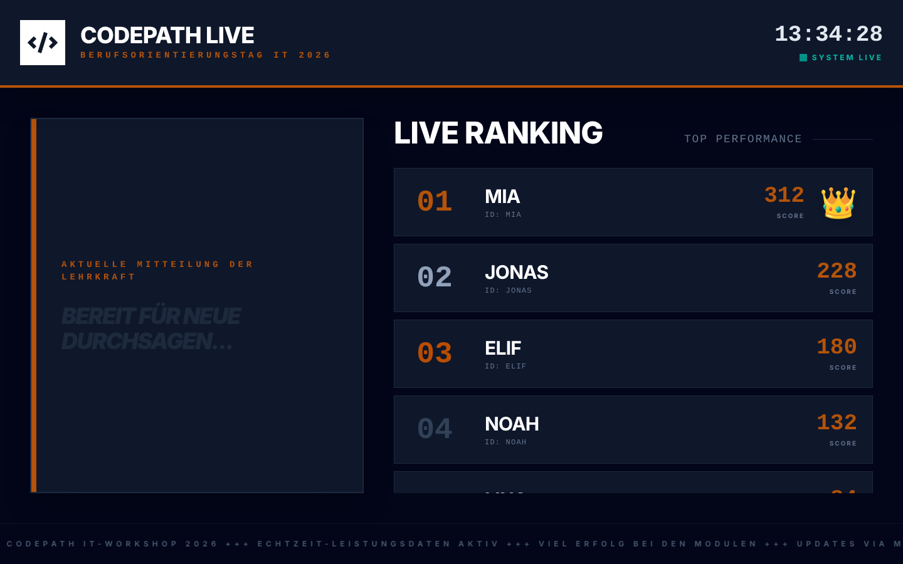
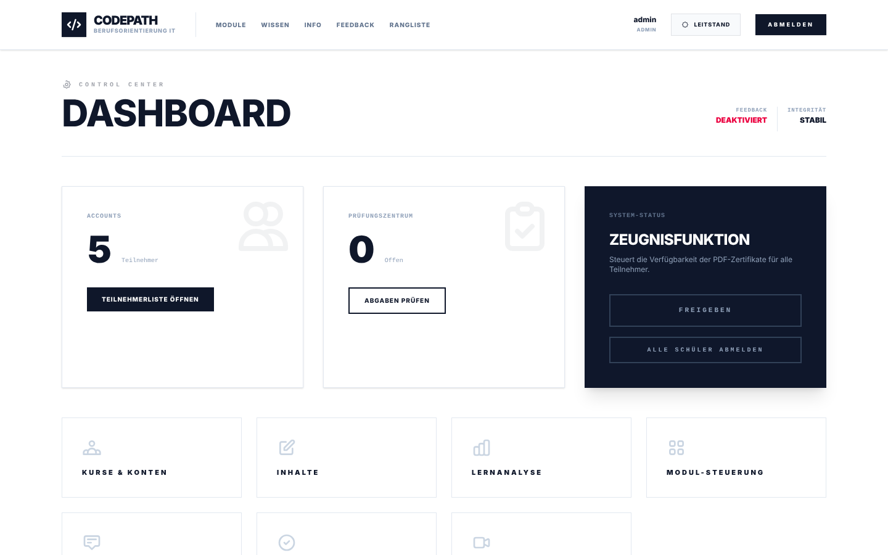
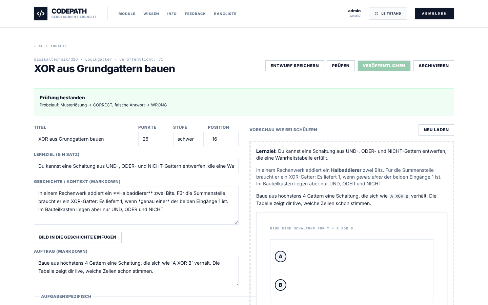

<p align="center">
  
</p>

<p align="center">
  <a href="https://github.com/Finn-Kraemer/CodePath/actions/workflows/ci.yml"></a>
  
  
  
  
  
</p>

**CodePath** ist eine Lernplattform für den IT-Berufsorientierungstag. Schülerinnen und Schüler der Klassen 7–9 schlüpfen in echte IT-Berufe – Entwicklerin, Datenbankadmin, Sicherheitsanalyst – und lösen Aufgaben, die sich wie die Arbeit dort anfühlen: Code schreiben, Datenbanken abfragen, Schaltungen bauen, Phishing-Mails entlarven, eine kaputte Web-App mit den Entwicklerwerkzeugen untersuchen.

Die Lehrkraft eröffnet einen Kurs, schaltet Module frei, verfolgt den Fortschritt live, bewertet Praxisabgaben und stellt Teilnahmebestätigungen aus. CodePath läuft auf einem Schulserver oder Laptop – zwei Container, keine Cloud, nach der Installation komplett offline.

---

## ◼ Auf einen Blick

| | |
|---|---|
| **11 Module, 147 Aufgaben** | Programmierung, Web-Entwicklung, IT-Sicherheit, Datenbanken, Künstliche Intelligenz, Cloud & Netzwerke, Digitaltechnik, Kommandozeile, Git, Algorithmen – und ein Abschlusstest |
| **15 Aufgabentypen** | von Auswahl und Lückentext über Python, SQL und Terminal mit Git bis zu Logikgattern, Markieren im Bild und dem Browser-Labor ([Übersicht](docs/aufgabentypen.md)) |
| **Fair bewertet** | ausschließlich auf dem Server; Lösungen erreichen nie den Browser, Codes und Zahlen sind je Person verschieden |
| **Für den Unterricht gebaut** | Kurse mit Beitrittscode, Freigaben und Fristen, gestufte Hinweise, Live-Rangliste für den Beamer, Rubrik-Bewertung |
| **Inhalte ohne Programmieren** | Editor mit Vorschau und Probelauf, Versionen, Bilder-Upload, Export und Import als ZIP |
| **Datensparsam** | selbst gehostet, keine Fremdabrufe, Kurs beenden löscht alle Schülerdaten |

## ◼ Einblicke

<table>
  <tr>
    <td width="50%"><br><sub><b>LERNMODULE</b> · jedes Modul ist ein Berufsfeld mit eigener Geschichte</sub></td>
    <td width="50%"><br><sub><b>LOGIKGATTER</b> · Schaltplan und Wahrheitstabelle rechnen live mit</sub></td>
  </tr>
  <tr>
    <td><br><sub><b>IM BILD MARKIEREN</b> · Sicherheitsrisiken am Arbeitsplatz finden</sub></td>
    <td><br><sub><b>BEAMER-MODUS</b> · Live-Rangliste und Mitteilungen für den Raum</sub></td>
  </tr>
  <tr>
    <td><br><sub><b>CONTROL CENTER</b> · Kurse, Abgaben, Freigaben und Auswertung</sub></td>
    <td><br><sub><b>EDITOR</b> · Aufgaben anlegen, prüfen und veröffentlichen – ohne Deployment</sub></td>
  </tr>
</table>

## ◼ Schnellstart

Voraussetzung: ein Rechner mit Docker und Docker Compose.

```bash
curl -O https://raw.githubusercontent.com/finn-kraemer/codepath/main/docker-compose.yml
curl -o .env https://raw.githubusercontent.com/finn-kraemer/codepath/main/.env.example
# In .env POSTGRES_PASSWORD setzen, z. B.: openssl rand -base64 32
docker compose up -d
```

| | |
|---|---|
| **Oberfläche** | [http://localhost:8080](http://localhost:8080) |
| **Anmeldung Lehrkraft** | Benutzer `admin`, Passwort aus `ADMIN_SEED_PASSWORD` – leer gelassen, steht es im Log: `docker compose logs app \| grep "Erzeugtes Passwort"` |
| **Erster Kurs** | Leitstand → *Kurse & Konten* → Kurs anlegen → Beitrittscode an die Klasse geben |

Es gibt bewusst keine Standardpasswörter: Ohne `POSTGRES_PASSWORD` startet der Stack nicht. Für HTTPS, Backups, Updates und den optionalen Code-Runner siehe **[Betriebshandbuch](docs/betrieb.md)**.

## ◼ Dokumentation

| Für | Dokument |
|---|---|
| Lehrkräfte | **[Handbuch für Lehrkräfte](docs/lehrkraefte.md)** – Kurs vorbereiten, Unterricht begleiten, bewerten, Inhalte pflegen |
| Alle, die Aufgaben auswählen oder schreiben | **[Aufgabentypen](docs/aufgabentypen.md)** – was jeder Typ prüft und wie er bewertet; Format in [`content/README.md`](content/README.md) |
| IT-Betreuung | **[Betriebshandbuch](docs/betrieb.md)** – Installation, Konfiguration, HTTPS, Backup, Update, Code-Runner, Fehlersuche |
| Datenschutz und Sicherheit | **[Sicherheit und Datenschutz](docs/sicherheit.md)** |
| Entwicklung | **[Entwicklerhandbuch](docs/entwicklung.md)** – Architektur, lokale Umgebung, Tests, neue Aufgabentypen |
| Hintergrund | [Architekturentscheidungen](docs/adr/) · [Browser-Labor](docs/browser-labor.md) · [Änderungsprotokoll](CHANGELOG.md) · [Historie der Überarbeitung](docs/historie/) |

Alle Dokumente im Überblick: **[docs/](docs/README.md)**.

## ◼ Technik

```
            Browser (SvelteKit, statisch)
                        │  HTTPS, Session-Cookie, Server-Sent Events
┌───────────────────────┴───────────────────────┐
│  app   Spring Boot 4.1 · Java 25              │──── runner (optional)
│        API · Bewertung · Live-Updates · UI    │     Python in bubblewrap-Sandbox
└───────────────────────┬───────────────────────┘
                        │
                 PostgreSQL 17
     Daten · Sessions · Aufgabenversionen · Bilder
```

Ein modularer Monolith (ADR-1): eine Anwendung, eine Datenbank, keine Message-Broker. Monaco-Editor, Pyodide und Schriften sind gebündelt, damit CodePath auch ohne Internet läuft. Details im [Entwicklerhandbuch](docs/entwicklung.md).

## ◼ Mitentwickeln

```bash
cd backend/dev-stack && ./start.sh                                  # PostgreSQL
cd backend && SPRING_DATASOURCE_PASSWORD=codepath ./mvnw spring-boot:run
cd frontend && pnpm install && pnpm dev                             # http://localhost:5173
```

Vor einem Pull Request laufen dieselben Prüfungen wie in der CI: `./mvnw verify` im Backend, `pnpm lint && pnpm check && pnpm test` im Frontend, `python content/validate.py` für Inhalte. Mehr im [Entwicklerhandbuch](docs/entwicklung.md).
