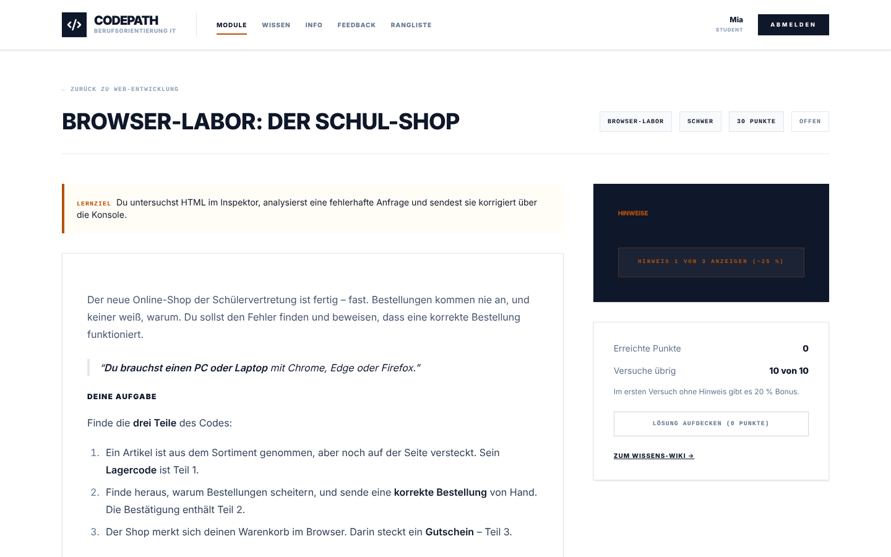

# Browser-Labor (`DEVTOOLS`)

Aufgaben für Fortgeschrittene und als Abschlusstest: Schülerinnen und Schüler untersuchen eine kleine Web-App in einem eigenen Tab mit den Entwicklerwerkzeugen des Browsers (Konsole, Inspektor, Netzwerkanalyse, Web-Speicher) und finden unterwegs die Teile eines Codes. Jedes Szenario verlangt mehrere Werkzeuge nacheinander; ein einzelner Befehl oder Blick reicht nicht.

## Szenarien

| Szenario | Teile | Weg |
|---|---|---|
| `wetter` – Die kaputte Wetterstation | 3 | Konsole meldet unvollständige Daten → im Netzwerk die abgeschaltete API-Version erkennen und v2 abrufen (Teil 1, dazu ein Schlüssel im Antwort-Header) → im Quelltext den Diagnosemodus finden, per localStorage einschalten (Teil 2) → Messverlauf in der Konsole mit dem Schlüssel abrufen (Teil 3) |
| `shop` – Der Schul-Shop | 3 | Ausgeblendeten Artikel im Inspektor finden (data-Attribut, Teil 1) → deaktivierten Button freischalten, fehlerhafte Anfrage im Netzwerk analysieren („menge muss eine Zahl sein“), korrigiert per `fetch()` senden (Teil 2) → Base64-Warenkorb aus dem sessionStorage mit `atob()` lesen (Teil 3) |
| `escape` – Das Escape-Zimmer (Abschlusstest) | 4 | Nur ein Rätselzettel: Text in einer CSS-Regel (`::after`, unsichtbar) → Inhalt einer 404-Antwort → rückwärts gespeicherter Eintrag in IndexedDB → Tür per Konsole mit den ersten drei Teilen öffnen; erst dann gibt der Server Teil 4 heraus |

Die Übungsaufgaben liegen im Modul Web-Entwicklung (`lab-wetter`, `lab-shop`), der Abschlusstest im eigenen Modul **Abschlusstest** (`abschlusstest/lab-escape`) – so schaltet die Lehrkraft ihn erst am Ende frei. Er erlaubt 5 Versuche und kein Aufdecken der Lösung.

## Wie es funktioniert

- **Eigener Tab:** Die Aufgabe verlinkt auf `/api/lab/<aufgabe>/`. Die Seiten kommen aus festen Vorlagen auf dem Server (`engine/lab`); Lehrkräfte wählen ein Szenario und schreiben Geschichte, Auftrag und Hinweise, aber kein HTML – so kann über den Editor kein Schadcode auf die Plattform gelangen.
- **Codes je Person:** Jeder Teil ist ein HMAC aus einem geheimen Schlüssel der Installation, der Person und der Aufgabe (4 Zeichen, ohne verwechselbare Zeichen). Abschreiben hilft nicht, und Codes lassen sich nicht vorhersagen. Der Schlüssel liegt in `system_settings` und bleibt über Neustarts gleich. Teilpunkte je richtigem Teil; 10 Versuche (Abschlusstest 5), damit Durchprobieren nicht geht.
- **Zugriff:** Schüler erreichen ein Labor nur für Aufgaben aus sichtbaren Modulen ihres Kurses. Die Lehrkraft sieht den Entwurf mit den Codes der Vorschau; die Probebewertung im Editor passt dazu.
- **Sicherheit:** Die Labor-Schnittstellen ändern keine echten Daten und sind deshalb von CSRF ausgenommen – Schüler sollen Anfragen von Hand senden können. Die Seiten laufen mit strenger CSP (nur eigene Skripte, nicht einbettbar), ohne Cache, Anfragen höchstens 10 KB.
- **Geräte:** Nur am PC oder Laptop mit Chrome, Edge oder Firefox. Tablets und Handys haben keine Entwicklerwerkzeuge; auf verwalteten Chromebooks können sie per Richtlinie gesperrt sein – vorher prüfen.

## Tests

- `BrowserLabTest`: spielt jedes Szenario nur über die Labor-Adressen durch und reicht den gefundenen Code ein; prüft Zugriff (abgemeldet, gesperrtes Modul, anderer Typ), Codes je Person und dass die Aufgabe selbst keinen Code verrät.
- `HandlersTest$DevTools`: Codes, Schreibweisen, Teilpunkte, andere Person.
- Playwright `browser-lab.spec.ts`: Wetterstation und Escape-Zimmer im echten Browser – Konsolenmeldung, localStorage, berechnetes CSS, IndexedDB, Konsolenfunktion.

## Neues Szenario hinzufügen

Eine Klasse in `engine/lab` implementiert `LabScenario` (`id`, `title`, `tools`, `parts`, `handle`) und ist eine Spring-Komponente. Teile kommen aus `codes.part(i)`, Zwischenschlüssel aus `codes.extra(...)`. Dann `scenario` in `content/schema/task.schema.json` und `DevToolsForm.svelte` ergänzen und einen Durchspiel-Test in `BrowserLabTest` schreiben.
