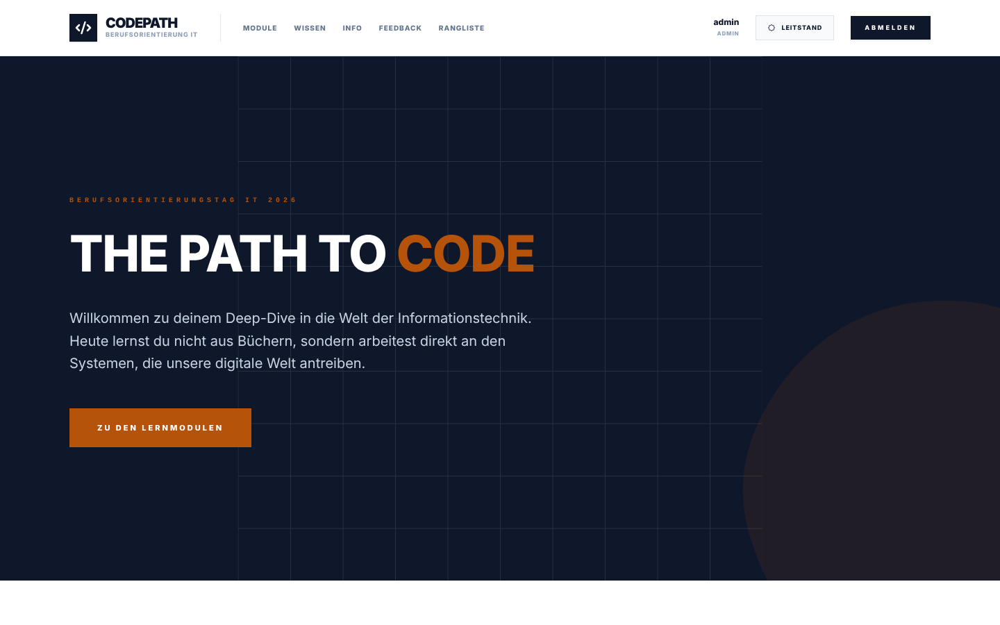

# Handbuch für Lehrkräfte

CodePath begleitet einen Berufsorientierungstag oder eine Projektwoche: Die Klasse arbeitet selbstständig an Modulen, die Lehrkraft steuert, was freigeschaltet ist, sieht den Fortschritt und bewertet, was sich nicht automatisch bewerten lässt. Dieses Handbuch folgt dem Ablauf eines Kurses.

> **Begriffe.** Ein **Modul** ist ein Berufsfeld (z. B. IT-Sicherheit) mit 10–18 Aufgaben. Ein **Kurs** ist eine Lerngruppe mit eigenem Beitrittscode, eigenen Freigaben und eigener Rangliste. Der **Leitstand** ist der Lehrkräfte-Bereich (Schaltfläche oben rechts nach der Anmeldung).

## ◼ 1. Vor dem Kurs

### Anmelden

Die Anmeldung als Lehrkraft erfolgt mit dem Benutzer `admin`. Das Passwort legt die IT-Betreuung bei der Installation fest (siehe [Betriebshandbuch](betrieb.md)) und lässt sich danach unter **Profil** ändern.

### Kurs anlegen

**Leitstand → Kurse & Konten → Kurs anlegen.** Name (z. B. „8b Projekttag“) und optional ein Enddatum eintragen. Jeder Kurs bekommt einen sechsstelligen **Beitrittscode**.

Die Klasse kann auf zwei Wegen beitreten:

| Weg | Ablauf | Geeignet für |
|---|---|---|
| **Selbst registrieren** | Schülerinnen und Schüler öffnen den Link (*Link kopieren*) oder geben den Code bei der Registrierung ein und wählen Benutzernamen und Passwort. Mit *Drucken* entsteht ein Aushang mit Code. | Ältere Klassen, eigene Geräte |
| **Konten anlegen** | Präfix und Anzahl eingeben (z. B. `8b-` und `28`). CodePath erzeugt Benutzernamen und Passwörter und zeigt sie **genau einmal** an – sofort drucken oder austeilen. | Jüngere Klassen, Leihgeräte, wenig Zeit |

Ein kompromittierter Code lässt sich mit *neuer Code* jederzeit ersetzen; bereits beigetretene Konten bleiben im Kurs.

### Module freischalten

**Leitstand → Modul-Steuerung**, oben den Kurs wählen. Jedes Modul ist zunächst gesperrt und wird mit *Freigeben* sichtbar. Optional eine **End-Uhrzeit** setzen: Ab dann sind Abgaben in diesem Modul nicht mehr möglich, der Countdown ist für die Klasse sichtbar.

### Einzelne Aufgaben freischalten oder sperren

Unter jedem Modul klappt **Einzelne Aufgaben** die Aufgabenliste auf. Je Aufgabe gibt es drei Stufen:

| Stufe | Wirkung |
|---|---|
| **Wie Modul** | Standard: sichtbar, sobald das Modul freigegeben ist |
| **Freigegeben** | sichtbar, auch wenn das Modul gesperrt ist – so lässt sich eine einzelne Aufgabe vorziehen |
| **Gesperrt** | ausgeblendet, auch wenn das Modul freigegeben ist |

Die Einstellung gilt nur für den gewählten Kurs. Aufgaben- und Punktzahl des Moduls, der Modulfortschritt der Schülerinnen und Schüler und die **Teilnahmebestätigung** zählen nur die sichtbaren Aufgaben. Gesperrte Aufgaben lassen sich nicht abgeben; bereits verdiente Punkte bleiben im Punktestand.

Empfehlung: Mit zwei oder drei Modulen beginnen und weitere im Laufe des Tages freigeben. Das Modul **Abschlusstest** erst am Ende freischalten.

### Geräte prüfen

Code-Aufgaben laufen im Browser mit; das Browser-Labor braucht die **Entwicklerwerkzeuge** (F12) und funktioniert nur am PC oder Laptop, nicht auf Tablets. Auf verwalteten Geräten vorher testen, ob die Entwicklerwerkzeuge freigegeben sind.

## ◼ 2. Während des Kurses

### Was die Klasse sieht

Jede Aufgabe hat eine kurze Geschichte, einen Auftrag und ein Lernziel. Pro Aufgabe gibt es bis zu drei **gestufte Hinweise**; jeder kostet 25 % der Punkte (höchstens 75 %). Wer im ersten Versuch ohne Hinweis löst, bekommt **20 % Bonus**. Die Lösung lässt sich aufdecken – danach gibt es keine Punkte mehr. Wie viele Versuche ein Typ erlaubt, steht in der [Übersicht der Aufgabentypen](aufgabentypen.md#-standardregeln).

### Lernpfad und empfohlene nächste Aufgabe

In der Modulübersicht steht oben die **empfohlene nächste Aufgabe**. Sie kommt aus dem ersten veröffentlichten Lernpfad; ohne Lernpfad empfiehlt CodePath die nächste offene Aufgabe – bevorzugt in einem Modul, das schon begonnen ist. Nach dem Lösen einer Aufgabe erscheint die Empfehlung auch auf der Aufgabenseite.

**Leitstand → Lernpfade** legt Lernpfade an. Ein neuer Lernpfad startet mit allen Modulen als Kette. Im Editor:

- **Station hinzufügen**: ein Modul, eine einzelne Aufgabe, ein **Lernpfad-Baustein** (`🧩`), eine **Bonus-Station** (`⭐`), ein Meilenstein (z. B. „Grundlagen geschafft!“), eine **Entweder-oder-Weiche** (`🔀`) oder ein **Logik-Block** (`UND` mit Symbol `&` bzw. `ODER` mit Symbol `≥1` oder `≥n` für „mindestens *n* von *m* Eingängen“). Ist eine Station gewählt, wird die neue darunter angehängt und verbunden. Logik-Blöcke brauchen mindestens zwei eingehende und eine ausgehende Verbindung und zählen ebenso wie Weichen und Bonus-Stationen nicht als eigene Station in „x/y Stationen“. Bei ODER-Blöcken bleiben alle Zweige offen; die Empfehlung „nächste Aufgabe“ bevorzugt den Zweig mit dem meisten Fortschritt.
- **Bonus-Stationen (`⭐`)**: Eine Station vom Typ *Bonus-Station* vergibt beim Erreichen eine feste Anzahl an Bonuspunkten (1 bis 1000 Punkte, frei einstellbar) im Punkte-Journal. Sie benötigt keine ausgehende Verbindung (kann als Sackgasse am Ende eines schweren Zweigs stehen) und zählt nicht zu den Pflichtstationen (`x/y erledigt`). Das System bucht die Punkte automatisch und idempotent, sobald alle Pflicht-Vorgänger abgeschlossen sind. Verzweigt eine Weiche in einen Weg mit Bonus-Stationen (auch innerhalb eingebundener Bausteine), zeigt die Weg-Auswahlkarte die erreichbaren Bonuspunkte direkt an (z. B. `+30 P.`). Wird eine Weiche später zurückgesetzt oder umgestellt, storniert CodePath die Bonuspunkte des verlassenen Wegs per Gegenbuchung im Punkte-Journal. Wird eine Bonus-Station manuell durch die Lehrkraft freigeschaltet, gilt sie als absolviert, vergibt jedoch keine Bonuspunkte.
- **Lernpfad-Bausteine (`🧩`)**: Ein bestehender Lernpfad lässt sich als wiederverwendbarer Baustein in andere Lernpfade einbinden (z. B. erst drei Grundlagen-Aufgaben, dann eine Entweder-oder-Weiche in die Bausteine *Schwerpunkt Cloud* oder *Schwerpunkt Web*). Mit dem Häkchen **Nur als Baustein** erscheint ein Lernpfad nicht einzeln in der Schüler-Auswahl, sondern nur als Baustein im Editor. Auf der Karte zeigt der Baustein seinen Fortschritt (`x/y erledigt`) und öffnet per Klick die eingebundene Karte mit einer Rücksprung-Leiste („← Zurück zu …“). Ist der Oberpfad verbindlich, gilt Verbindlichkeit auch innerhalb des Bausteins. Zyklen und mehr als zwei Verschachtelungsebenen werden verhindert; genutzte Bausteine sind gegen versehentliches Löschen geschützt.
- **Entweder-oder-Weiche (`🔀`)**: Eine Weiche verzweigt in mindestens zwei ausgehende Wege (jeweils mit Pflicht-Beschriftung und optionaler Kurzbeschreibung, z. B. „schwieriger – dafür +50 Punkte“). Der Editor färbt die exklusiven Stationen der einzelnen Wege farblich ein; Stationen hinter dem Zusammenführungspunkt bleiben gemeinsam. Sobald die Vorgänger der Weiche erfüllt sind, wählen Schülerinnen und Schüler explizit über „Diesen Weg nehmen“ (mit Bestätigungsdialog) ihren Weg – die nicht gewählten Zweige werden für sie dauerhaft gesperrt (*nicht gewählt*, auch in der Modulübersicht, per Direktlink und in der Wissensdatenbank).
- Stationen **ziehen** (oder mit den Pfeiltasten verschieben), **Verbinden** zeichnet „erst das, dann das“. Linien anklicken öffnet ihre Einstellung (*Pflicht* durchgezogen oder *Empfehlung* gestrichelt) oder löscht sie. Kreise sind nicht möglich.
- **Verbindlich**: Ist *Verbindlich* angehakt, müssen Pflicht-Vorgänger erledigt sein, bevor eine Station freigeschaltet wird. Vorher ist die Station für die Klasse gesperrt („Erst … abschließen“) – auf der Karte, auf der Modulseite und per Direktlink. Empfehlungs-Verbindungen (gestrichelt) bleiben sofort bearbeitbar. Pro Kurs ist höchstens ein verbindlicher Lernpfad möglich.
- **Alles außerhalb des Lernpfads**: *Frei* (folgt der Modul-Steuerung), *Gesperrt* (nur der Lernpfad ist sichtbar) oder *Frei ab Station …* – damit lassen sich z. B. erst drei Pflicht-Stationen vorgeben und ab dem Meilenstein „Freies Arbeiten“ automatisch alle übrigen Module freischalten.
- **Automatisch anordnen** legt die Stationen ordentlich in Reihen, **Vorschau** zeigt die Karte mit dem eigenen Stand oder wahlweise aus Sicht eines bestimmten Schülerkontos (*Als Schüler ansehen*).
- **Nur bestimmte Aufgaben**: Eine Modul-Station kann alle oder nur ausgewählte Aufgaben des Moduls nutzen. **Restliche Aufgaben als neue Station** hängt den Rest als zweite Station an – so entsteht z. B. *Programmierung 1 → Web 1 → Programmierung 2*.
- **Gilt für**: alle Kurse oder ein Kurs (Gruppe). Ein veröffentlichter Lernpfad für einen Kurs überträgt bei jedem Speichern seine Module in die **Modul-Steuerung** des Kurses: Die Module werden freigegeben, nicht genutzte Aufgaben darin einzeln gesperrt. Was sich geändert hat, zeigt der Editor nach dem Speichern; Fristen bleiben unverändert.
- **Veröffentlicht** ankreuzen und speichern – dann sieht die Klasse den Lernpfad als Karte (umschaltbar auf die Liste). Ein Kurs sieht die Lernpfade für ihn und die für alle Kurse; die Empfehlung kommt aus dem obersten Lernpfad des eigenen Kurses, sonst aus dem obersten für alle Kurse.

Auf der Karte ist jede Station *erledigt*, *jetzt dran*, *noch gesperrt* („Erst … abschließen“), *später*, *Zeit abgelaufen* oder *gesperrt*. Von der Lehrkraft gesperrte oder abgelaufene Vorgänger halten niemanden auf.

### Beamer-Modus

**Leitstand → Beamer-Modus** öffnet eine Vollbild-Ansicht für den Projektor: Live-Rangliste, Uhrzeit und die aktuelle Mitteilung. Die Rangliste aktualisiert sich bei jeder gelösten Aufgabe von selbst.

### Mitteilungen

**Leitstand → Live-Mitteilung.** Der Text erscheint sofort bei allen – je nach Anzeigeort in der Kopfzeile, auf der Info-Seite oder an beiden Stellen; der Beamer-Modus zeigt ihn immer. Gut für Zeitansagen („Noch 15 Minuten in Modul 2“) oder Hinweise an alle.

### Startseite bearbeiten

**Leitstand → Startseite.** Die Startseite besteht aus Abschnitten (Titelbereich, Textabschnitt, Aufzählung, Karten, Text mit Infobox, Ablauf, Text mit Tabelle, Bild, Aufruf mit Buttons). Links wählst du einen Abschnitt und änderst seine Texte, sortierst ihn mit ↑/↓ um, blendest ihn aus, duplizierst oder löschst ihn; *+ Abschnitt hinzufügen* fügt einen neuen hinter dem gewählten ein. Rechts siehst du sofort die Vorschau, ein Klick dort öffnet den Abschnitt zum Bearbeiten. Längere Texte verstehen Markdown (**fett**, Listen, Links); Bilder kommen aus der Medienverwaltung und sind auf der veröffentlichten Startseite auch ohne Anmeldung sichtbar.

*Entwurf speichern* sichert den Stand nur für dich, erst *Veröffentlichen* zeigt ihn allen. *Änderungen verwerfen* kehrt zur Live-Fassung zurück, *Auf Standard zurücksetzen* stellt die mitgelieferte Startseite wieder her. Ein neuer Build oder Neustart ist dafür nicht nötig.

### Eigene Seiten

**Leitstand → Seiten.** Neue Seiten wie „Anfahrt“, „Ablauf“ oder „Kontakt“ anlegen: Titel eingeben, die Adresse (`/seiten/…`) wird vorgeschlagen. Bearbeitet wird mit demselben Abschnitts-Editor wie die Startseite, ebenfalls mit Entwurf und *Veröffentlichen*. Jede veröffentlichte Seite erscheint automatisch im Aufklappmenü **„Seiten“** in der Menüleiste und in der **Seitenübersicht** (`/seiten`, mit Kurzbeschreibung als Kachel). In den Einstellungen jeder Seite legst du fest, ob sie **nur für Angemeldete** oder **für alle** sichtbar ist, gibst ihr eine Kurzbeschreibung und kannst sie **zusätzlich direkt in die Menüleiste** holen; die Reihenfolge stellst du in der Seitenliste mit ↑/↓ ein. *Offline nehmen* versteckt eine Seite wieder, ohne den Entwurf zu verlieren.

### Wissensdatenbank bearbeiten

**Leitstand → Wissensdatenbank** (oder *Artikel bearbeiten* in der Wissensdatenbank). Artikel werden in Markdown geschrieben, rechts steht die Vorschau; *Bild einfügen* setzt ein Bild aus der Medienverwaltung an die Cursorposition. Pro Artikel wählst du, wann Schüler ihn sehen: **immer** (Grundlagen) oder **erst, wenn ein bestimmtes Modul freigegeben ist**. Neue Artikel sind zunächst Entwurf und nur für dich sichtbar, bis du *Veröffentlicht* anhakst. Mitgelieferte Artikel, die du nicht verändert hast, werden bei Updates auf die neue Fassung gebracht; sobald du einen Artikel bearbeitest, bleibt deine Fassung erhalten. Gelöschte mitgelieferte Artikel kommen bei Updates nicht zurück.

**Artikel verlinken:** Im Editor fügt *Artikel verlinken* einen Link auf einen anderen Artikel ein (markierter Text wird zum Linktext). Bei jeder Aufgabe kannst du unter *Passender Wissensartikel* einen Artikel wählen; Schüler sehen dann neben der Aufgabe „Mehr dazu im Wiki“. Ohne Auswahl wird automatisch der Artikel zum Modul der Aufgabe verlinkt, sofern es einen gibt und er für die Schüler sichtbar ist.

**Suche:** Über der Artikelliste gibt es ein Suchfeld. Gesucht wird in Titel und Text aller Artikel, die man sehen darf; alle Suchwörter müssen vorkommen. Treffer erscheinen mit Textausschnitt, im geöffneten Artikel sind die Fundstellen markiert.

### Fortschritt verfolgen

| Ansicht | Zeigt |
|---|---|
| **Teilnehmerliste** | Alle Schülerinnen und Schüler mit Punkten und Fortschritt; Klick öffnet die Akte |
| **Schülerakte** | Reiter **Aufgaben**: Jede Aufgabe mit Status und Versuchen (als gelöst werten, sperren/entsperren, neues Passwort vergeben). Reiter **Lernpfad**: Karte aus Sicht der Schülerin oder des Schülers, getroffene Entscheidungen an Weichen (auch in eingebundenen Bausteinen) mit Aktionen zum **Wahl zurücksetzen** (wahlweise Fortschritt behalten oder Fortschritt und Punkte im verlassenen Weg über eine Korrekturbuchung zurücknehmen), **Wahl für Schüler setzen**, **weiteren Weg zusätzlich freischalten** und **einzelne Stationen freischalten** (hebt die Blockierung durch Pflicht-Vorgänger auf; die Station gilt als erledigt für Nachfolger). Auch kursweit als Sammelaktion im Lernpfad-Editor unter *Weichen-Übersicht im Kurs* verfügbar |
| **Lernanalyse** | Je Aufgabe: wie viele es versucht haben, Fehlversuche, Lösungsquote – zeigt, wo die Klasse hängt |

Mit **Alle Schüler abmelden** im Control Center endet jede laufende Sitzung, z. B. am Ende des Tages an geteilten Geräten.

## ◼ 3. Bewerten

Praxisaufgaben (Typ *Praxis*) bewertet die Lehrkraft selbst. Neue Abgaben erscheinen im **Prüfungszentrum** (*Abgaben prüfen*).

1. Abgabe öffnen – links die Aufgabenstellung, rechts die Antwort. Hat die Aufgabe eine Python-Werkbank, steht darunter der abgegebene Code und lässt sich direkt ausführen.
2. Für jedes Kriterium der **Rubrik** die Punkte wählen; die Summe ergibt die Punkte der Aufgabe.
3. Optional einen **Kommentar** für die Schülerin oder den Schüler schreiben.
4. **Annehmen** – oder **Zur Überarbeitung zurückgeben**: Die Antwort bleibt im Editor der Schülerin erhalten und kann verbessert werden. Mit *Aufgabe danach endgültig sperren* gibt es keine weitere Abgabe.

Alle anderen Typen bewertet CodePath sofort und ausschließlich auf dem Server.

## ◼ 4. Nach dem Kurs

### Teilnahmebestätigungen

Im Control Center unter *Zeugnisfunktion* die Bestätigungen **freigeben**: Schülerinnen und Schüler laden ihre PDF dann im Profil herunter. Unter **Kurse & Konten → Zeugnisse (ZIP)** lädt die Lehrkraft alle Bestätigungen eines Kurses auf einmal herunter.

### Feedback einholen

**Leitstand → Feedback** startet eine Feedback-Runde; die Klasse kann danach einmal Rückmeldung geben. Die Antworten erscheinen auf derselben Seite.

### Mitnehm-Paket

Im Profil laden Schülerinnen und Schüler ihr **Mitnehm-Paket** als PDF herunter: Ergebnisse je Aufgabe, eigener Code (letzte Abgabe bei Python-, SQL-, Terminal- und Praxisaufgaben), **Berufe-Kompass** und Links zum Weiterlernen. Das PDF entsteht beim Herunterladen und wird nicht gespeichert – auch nicht im Protokoll. Die Klasse vor dem Kursende daran erinnern.

Der **Berufe-Kompass** ordnet jedem Modul ein Berufsfeld zu und zeigt die drei Felder, in denen jemand anteilig die meisten Punkte geholt hat. Berufsfeld und Links pflegt die Lehrkraft unter **Inhalte → Modul bearbeiten**.

### Kurs beenden

**Kurse & Konten → Kurs beenden** löscht **alle Schülerkonten des Kurses mit Fortschritt, Versuchen, Abgaben und Punkten**. Das ist aus Datenschutzgründen so gewollt und lässt sich nicht rückgängig machen – vorher die Bestätigungen exportieren. Der Beitrittscode ist danach ungültig.

## ◼ 5. Inhalte bearbeiten

**Leitstand → Inhalte** zeigt alle Module und Aufgaben. Änderungen werden ohne Neustart wirksam.

### Aufgabe bearbeiten

1. Aufgabe öffnen. Links stehen die Felder, rechts die **Vorschau** genau so, wie die Klasse sie sieht – mit Probebewertung beliebiger Antworten, ohne dass etwas gespeichert wird.
2. Texte sind Markdown (`**fett**`, `` `Code` ``, Listen, Tabellen). Mit **Bild in die Geschichte einfügen** kommt ein Bild hinzu (PNG, JPEG, GIF, WebP bis 2 MB).
3. **Entwurf speichern** – die Klasse sieht weiter die veröffentlichte Version.
4. **Prüfen** – CodePath kontrolliert die Konfiguration und macht einen Probelauf: Die Musterlösung muss als richtig, eine falsche Antwort als falsch bewertet werden.
5. **Veröffentlichen** – ab jetzt gilt die neue Version. Bisherige Versuche bleiben an der Version, mit der sie entstanden sind; niemandem gehen Punkte verloren.

Unter *Versionen* lässt sich jede frühere Fassung als Entwurf zurückholen.

**Python-Werkbank für Praxisaufgaben:** Im Formular einer Praxisaufgabe *Python-Werkbank anzeigen* ankreuzen. Die Klasse bekommt dann zusätzlich einen Python-Editor mit Eingabefeld und kann auch größere Programme im Browser ausführen (bis 10 Sekunden). Optional einen *Startcode* vorgeben und festlegen, dass der Code mit abgegeben werden muss.

### Reihenfolge ändern

In der Modulliste Aufgaben am Griff **⠿** an die neue Stelle ziehen oder mit **▲ ▼** verschieben – wird Aufgabe 3 an Stelle 10 gezogen, ist sie danach Aufgabe 10. Die Reihenfolge gilt sofort für alle Kurse und bleibt bei *Mitgelieferte Inhalte übernehmen* und Importen erhalten.

### Neue Aufgabe

In der Modulliste unter *Neue Aufgabe* Titel, Slug (Kurzname für die Adresse, z. B. `passwort-check`) und Typ wählen und **Anlegen**. CodePath füllt eine Vorlage des Typs aus, die sofort geprüft und angepasst werden kann. Neue Module entstehen über *Modul anlegen*.

### Archivieren und löschen

| Aktion | Wirkung | Rückgängig? |
|---|---|---|
| **Archivieren** | Die Aufgabe verschwindet für die Klasse. Versuche, Ergebnisse und Punkte bleiben erhalten. | Ja, *Wiederherstellen* |
| **Endgültig löschen** (nur archivierte Aufgaben) | Entfernt die Aufgabe mit allen Versionen, Versuchen, Fortschritten und **Punkten** – die Rangliste ändert sich. CodePath zeigt vorher, was verloren geht; bestätigt wird durch Eintippen des Slugs. | Nein |

Gelöschte mitgelieferte Aufgaben kommen auch bei Updates nicht wieder – außer über einen bewussten ZIP-Import.

### Austausch und Sicherung

**Leitstand → Import & Export** sichert Einstellungen, Startseite, Seiten, Wissensdatenbank, Lernpfade sowie Module und Aufgaben (mit Bildern) in **einer** ZIP-Datei – alles oder nur ausgewählte Bereiche. Einzelne Bereiche und einzelne Lernpfade lassen sich auch in ihren Editoren exportieren. Schülerdaten sind nie enthalten.

Der **zentrale Import** erkennt die Datei selbst (CodePath-Export als ZIP oder JSON, oder ein Content-Paket) und zeigt danach für jeden Eintrag, ob er **angelegt**, **überarbeitet** (gab es schon) oder **unverändert** gelassen wurde – oder warum ein **Fehler** auftrat. Ein fehlerhafter Eintrag hält die übrigen nicht auf. Gleiche Adresse (Slug) heißt „derselbe Eintrag“; gelöscht wird nichts.

- **Export (ZIP)** unter Inhalte speichert nur Module und Aufgaben.
- **Import** unter Inhalte nimmt dieselben Dateien wie der zentrale Import; geänderte Aufgaben werden zu neuen Versionen.
- **Mitgelieferte Inhalte übernehmen** holt nach einem Update die überarbeiteten Startinhalte in die Datenbank.

Das Format beschreibt [`content/README.md`](../content/README.md).

## ◼ Häufige Fragen

**Eine Schülerin hat ihr Passwort vergessen.** Schülerakte öffnen → *Passwort überschreiben*.

**Eine Aufgabe ist fehlerhaft und alle verlieren Versuche.** Korrigieren und neu veröffentlichen; in der Schülerakte lassen sich Aufgaben einzeln als gelöst werten oder entsperren.

**Code-Aufgaben zeigen „Übung ohne Punkte“.** Auf diesem Server ist kein Code-Runner eingerichtet; Code-Aufgaben lassen sich üben, zählen aber nicht. Die IT-Betreuung kann ihn einschalten ([Betriebshandbuch](betrieb.md#-code-runner)).

**Kann die Klasse von zu Hause weiterarbeiten?** Ja, sofern der Server von außen erreichbar ist (siehe [Betriebshandbuch](betrieb.md#-https-und-erreichbarkeit)). Freigaben und Fristen gelten überall.
